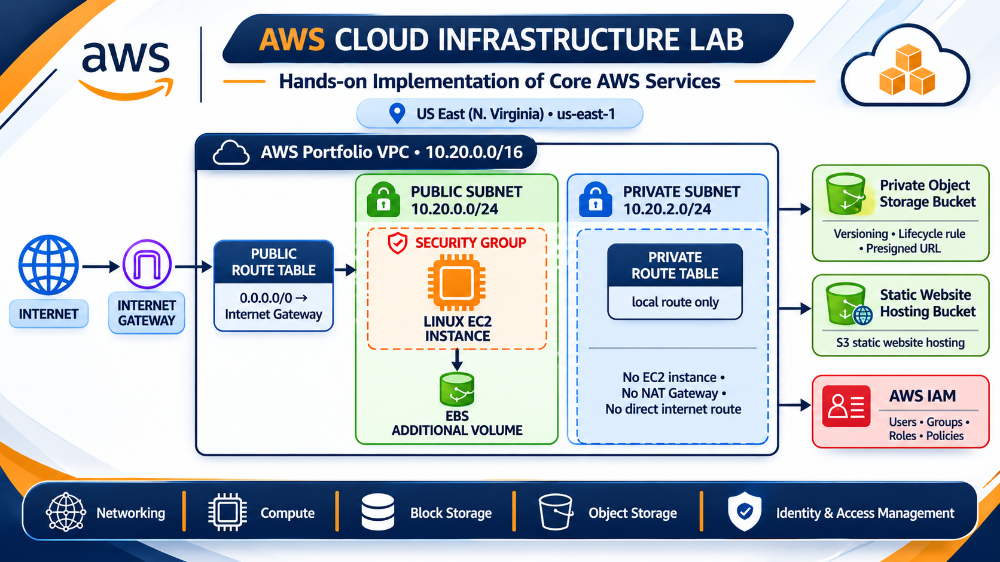
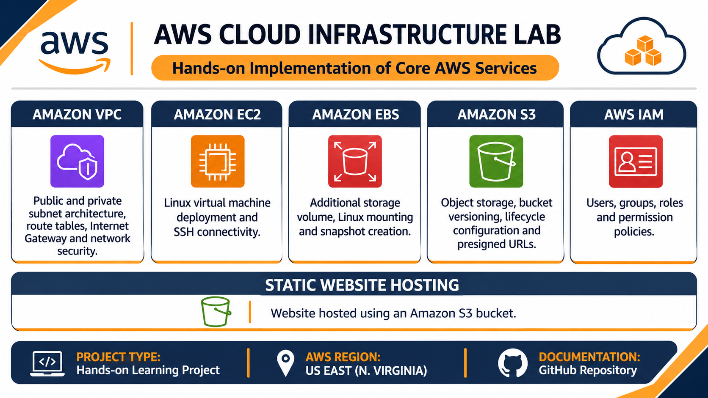

# AWS Cloud Infrastructure Lab

A hands-on AWS project demonstrating practical experience with core cloud infrastructure services, networking, compute, storage, and identity management.

## Project Overview

This project was created to gain practical experience configuring and managing AWS services using the AWS Management Console, AWS CLI, and Linux command line.

The lab covers a custom VPC environment, EC2 Linux instance deployment, EBS storage management, S3 object storage, IAM access control, and S3 static website hosting.

## Architecture Diagram

## Project Overview Diagram

## AWS Services Implemented

| AWS Service | Practical Implementation |
|---|---|
| **Amazon VPC** | Created a custom VPC with public and private subnets, route tables, and an Internet Gateway |
| **Amazon EC2** | Launched and accessed a Linux EC2 instance using SSH |
| **Amazon EBS** | Attached an additional EBS volume, mounted it on Linux, and created a snapshot |
| **Amazon S3** | Practiced object storage, bucket versioning, lifecycle configuration, and presigned URLs |
| **AWS IAM** | Practiced users, groups, roles, and permission policies |
| **S3 Static Website Hosting** | Hosted a static website using an S3 bucket |

## Practical Work

### 1. Amazon VPC
- Created a custom VPC with CIDR block `10.20.0.0/16`.
- Created public and private subnets.
- Configured route tables.
- Attached an Internet Gateway.
- Configured public subnet internet routing.

### 2. Amazon EC2
- Launched a Linux EC2 instance in the public subnet.
- Configured security group access.
- Connected to the instance using SSH.
- Practiced basic Linux commands.

### 3. Amazon EBS
- Attached an additional EBS volume to EC2.
- Identified and prepared the storage device in Linux.
- Mounted the additional volume.
- Created an EBS snapshot.

### 4. Amazon S3
- Created S3 buckets.
- Uploaded and managed objects.
- Enabled bucket versioning.
- Practiced object version recovery.
- Configured lifecycle management.
- Generated presigned URLs.
- Practiced static website hosting using a separate S3 bucket.

### 5. AWS IAM
- Created IAM users and groups.
- Practiced managed and custom permission policies.
- Created IAM roles.
- Explored permissions and access management.

## Repository Structure

| Folder | Description |
|---|---|
| `Architecture/` | AWS architecture and project overview diagrams |
| `VPC/` | VPC and networking screenshots |
| `EC2/` | EC2 instance and SSH screenshots |
| `EBS/` | EBS volume and snapshot screenshots |
| `S3/` | S3 storage and configuration screenshots |
| `IAM/` | IAM users, groups, roles, and policies |
| `Website/` | S3 static website hosting screenshots |

## Skills Demonstrated

- AWS Cloud Fundamentals
- VPC Networking
- EC2 Instance Management
- Linux Administration
- SSH Connectivity
- EBS Storage Management
- S3 Object Storage
- IAM Access Management
- AWS CLI
- Static Website Hosting

## Project Status

**Completed — AWS lab resources cleaned up after testing.**

All AWS resources used during the practical exercises have been cleaned up after testing to avoid unnecessary ongoing charges.

Screenshots, architecture diagrams, and project documentation are retained in this repository as evidence of the practical work.

## Disclaimer

This is a personal hands-on learning project created for educational and portfolio purposes. It is not a production deployment.
